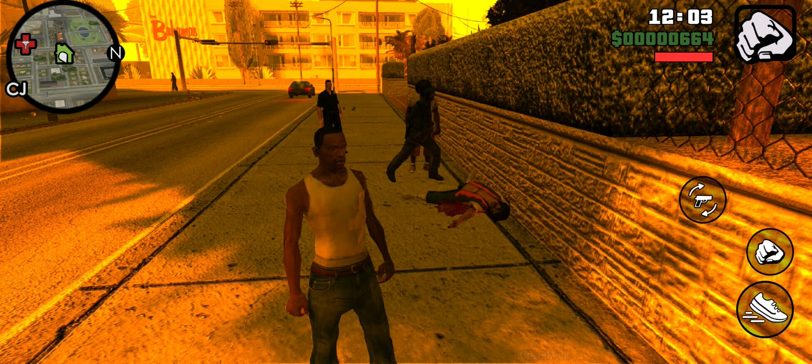
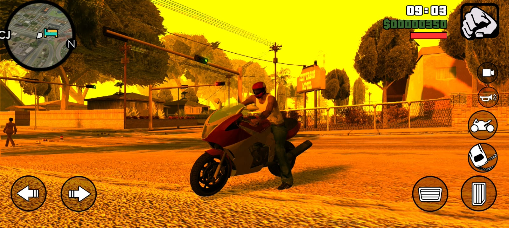

# BetaRealismAction

A native Android Mod Loader (AML) plugin for **GTA: San Andreas Android**. It adds a limited NPC response to nearby dead pedestrians and equips the player with a helmet on powered motorcycles.

## Screenshots

| Dead-pedestrian response | Motorcycle helmet |
| --- | --- |
|  |  |

## Features

- Detects nearby dead pedestrians and selects a corpse for the current response.
- Assigns one nearby responder to approach the corpse and call for an ambulance.
- Gives other eligible nearby pedestrians a brief, one-time reaction.
- Applies one of two native player helmet clothing variants on powered motorcycles and restores the saved clothing descriptor after dismounting.

## Requirements

- GTA: San Andreas for Android, version 2.10
- Android Mod Loader (AML) 
- ARM64 Android device

## Installation

1. Build the plugin or obtain the matching ARM64 `.so` release.
2. Copy `libBetaRealismAction.so` into the AML mods directory used by your GTA SA installation.
3. Launch the game.
